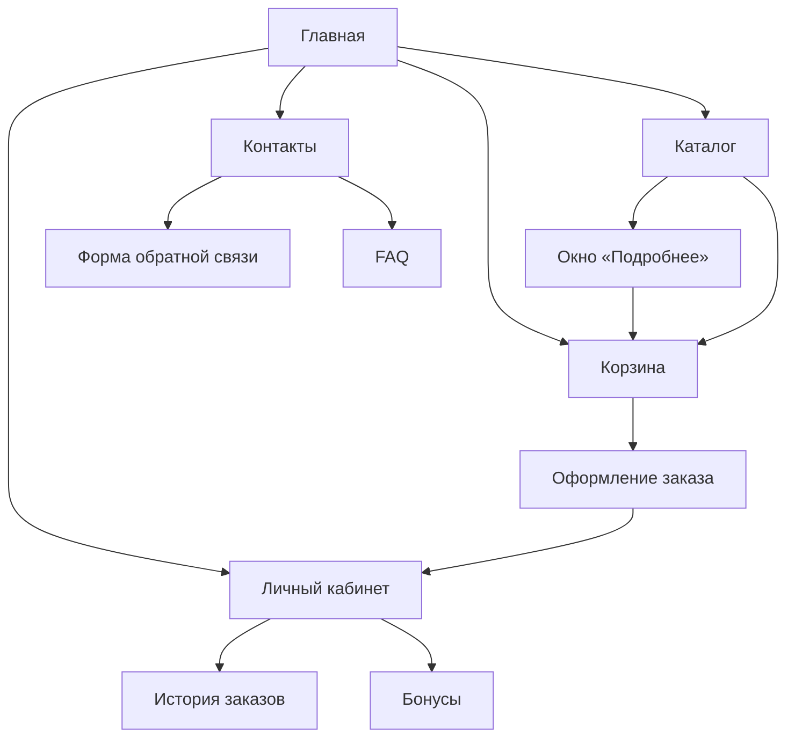
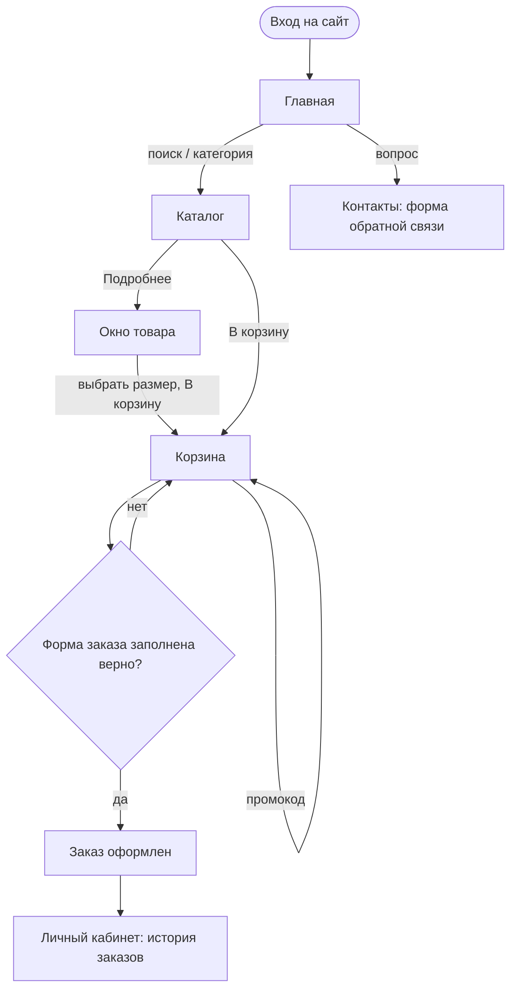

# Style Market — информационная архитектура сайта

## 1. Цель сайта

**Style Market** — интернет-магазин модной одежды, обуви и аксессуаров (веб-версия мобильного приложения).

**Какую проблему решает:** покупателю не нужно ходить по торговым центрам — он может за несколько минут найти вещь по названию или категории, посмотреть описание и размеры, сложить товары в корзину и оформить доставку на дом.

**Для кого:** молодёжь и взрослые 16–40 лет, которые следят за модой и ценят своё время; покупатели, которые хотят получать скидки и бонусы за покупки.

## 2. Основные разделы сайта (5 разделов)

| № | Раздел | Файл | Что размещено внутри |
|---|--------|------|----------------------|
| 1 | Главная | `index.html` | Баннер с коллекцией, строка поиска, категории товаров, хиты продаж, преимущества магазина, форма подписки на рассылку |
| 2 | Каталог | `catalog.html` | Поиск по названию, фильтр по категориям, сортировка по цене/названию, карточки товаров, окно «Подробнее» (описание, выбор размера), таблица размеров |
| 3 | Корзина | `cart.html` | Список выбранных товаров, изменение количества, удаление, промокод, расчёт итоговой суммы и доставки, форма оформления заказа |
| 4 | Личный кабинет | `account.html` | Вход и регистрация, профиль пользователя, бонусный баланс, история заказов |
| 5 | Контакты | `contacts.html` | Телефон, e-mail, мессенджер, таблица адресов магазинов, форма обратной связи, частые вопросы (FAQ) |

## 3. Взаимосвязь разделов

- **Шапка (header + nav)** присутствует на всех страницах — из любого раздела можно перейти в любой другой. В пункте «Корзина» отображается счётчик товаров.
- **Подвал (footer)** дублирует навигацию и контакты.
- Главная → Каталог: кнопка «Перейти в каталог», строка поиска (`catalog.html?q=...`), карточки категорий (`catalog.html?cat=...`), ссылка «Смотреть весь каталог».
- Главная → Личный кабинет: кнопка «Регистрация».
- Главная / Каталог → Корзина: кнопки «В корзину» (товар сохраняется, счётчик в шапке обновляется).
- Корзина → Каталог: кнопка «Перейти в каталог», если корзина пуста.
- Корзина → Личный кабинет: оформленный заказ появляется в «Истории заказов», начисляются бонусы.
- Личный кабинет → Каталог: ссылка «Выбрать товары», если заказов нет.

## 4. Структурная схема сайта (Sitemap)

```
Style Market
│
├── Главная (index.html)
│   ├── Баннер + поиск
│   ├── Категории ──────────────► Каталог (с фильтром)
│   ├── Хиты продаж ────────────► Корзина
│   ├── Преимущества
│   └── Подписка на рассылку
│
├── Каталог (catalog.html)
│   ├── Поиск / Фильтры / Сортировка
│   ├── Карточки товаров
│   │   └── Окно «Подробнее» (размер, описание) ──► Корзина
│   └── Таблица размеров
│
├── Корзина (cart.html)
│   ├── Список товаров (кол-во, удаление)
│   ├── Итог + промокод
│   └── Оформление заказа ─────────────────► Личный кабинет (история)
│
├── Личный кабинет (account.html)
│   ├── Вход / Регистрация
│   └── Профиль
│       ├── Бонусный баланс
│       └── История заказов
│
└── Контакты (contacts.html)
    ├── Контактная информация
    ├── Адреса магазинов (таблица)
    ├── Форма обратной связи
    └── Частые вопросы
```



## 5. Схема взаимодействия пользователя (User Flow)

Основной сценарий — покупка товара:

```
[Пользователь открывает сайт]
          │
          ▼
   ┌──────────────┐
   │   Главная    │── ввод в строку поиска ──┐
   └──────────────┘                          │
          │ выбор категории                  │
          ▼                                  ▼
   ┌──────────────────────────────────────────────┐
   │ Каталог: фильтр / сортировка / поиск          │
   └──────────────────────────────────────────────┘
          │ нажатие «Подробнее»
          ▼
   ┌──────────────────────────────┐
   │ Окно товара: выбор размера    │
   └──────────────────────────────┘
          │ «Добавить в корзину» (счётчик в шапке +1)
          ▼
   ┌──────────────────────────────┐
   │ Корзина: кол-во, промокод     │
   └──────────────────────────────┘
          │ заполнение формы (имя, телефон, адрес, оплата)
          ▼
   < Данные введены верно? > ── нет ──► подсказка браузера, исправить
          │ да
          ▼
   ┌──────────────────────────────┐
   │ «Заказ №… оформлен!»          │
   └──────────────────────────────┘
          │
          ▼
   ┌──────────────────────────────┐
   │ Личный кабинет: история,      │
   │ начислены бонусы              │
   └──────────────────────────────┘
```



## 6. Действия пользователя на сайте

1. Переход между разделами (меню, бургер-меню на телефоне, ссылки в подвале).
2. Ввод текста в строку поиска (на главной и в каталоге — фильтрация «на лету»).
3. Фильтрация по категориям и сортировка товаров.
4. Просмотр информации о товаре в окне «Подробнее» и выбор размера.
5. Добавление в корзину, изменение количества, удаление, ввод промокода `STYLE10`.
6. Ввод данных в формы: заказ, регистрация/вход, обратная связь, подписка.
7. Раскрытие ответов в разделе «Частые вопросы».
